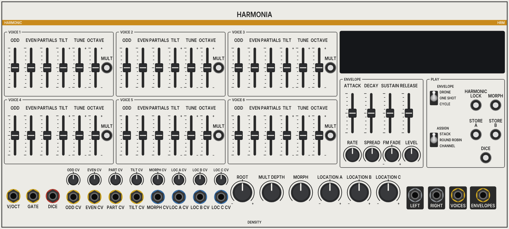
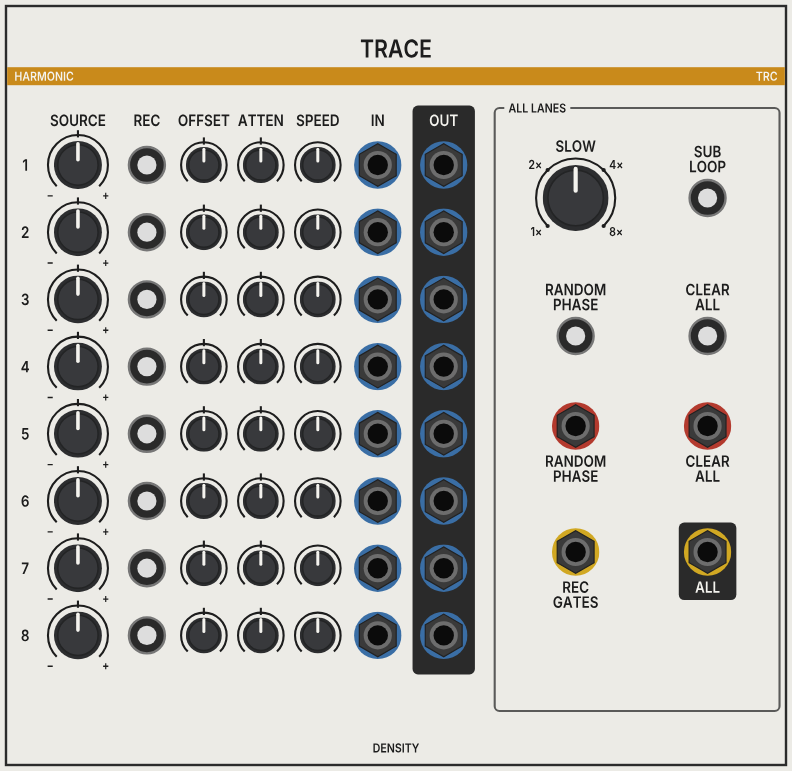
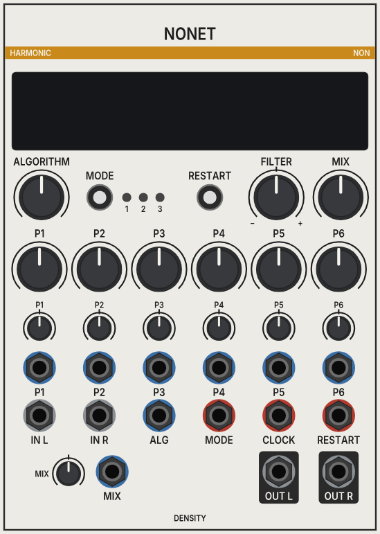
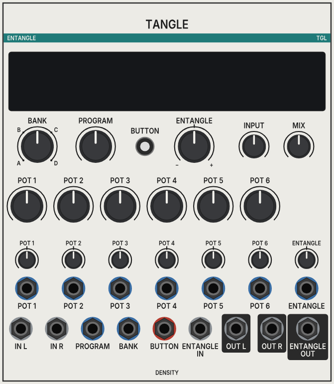
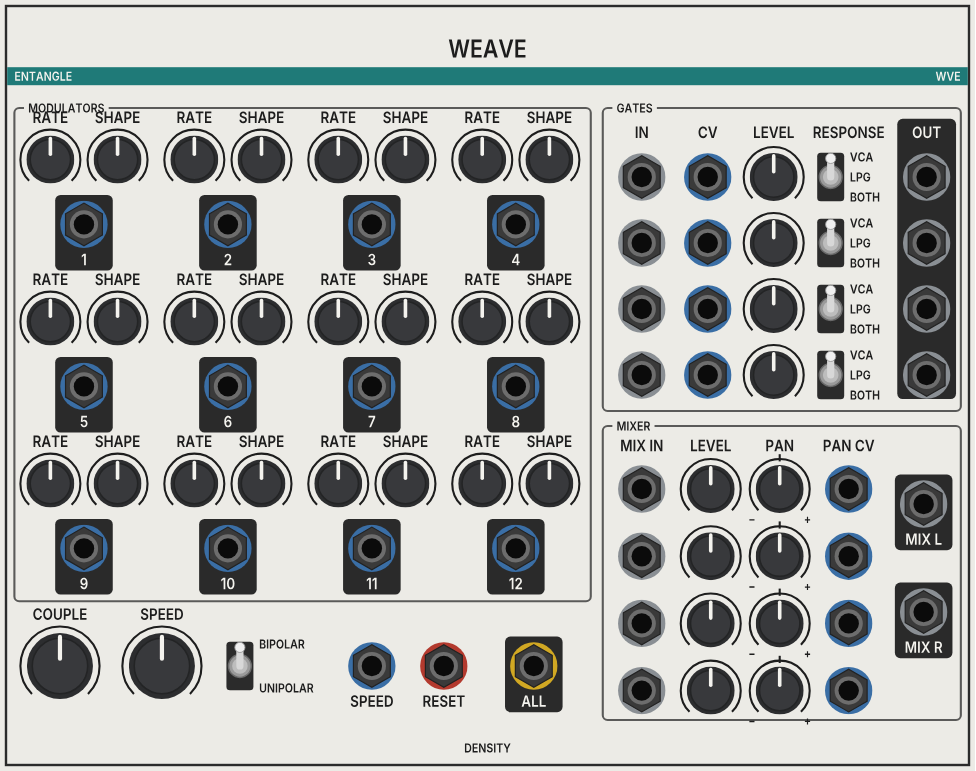
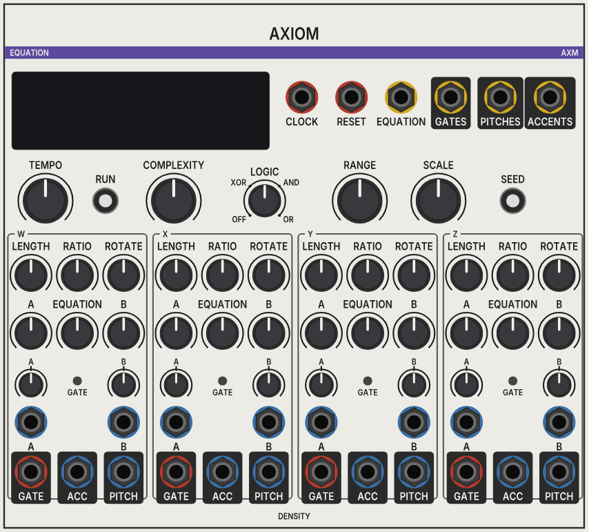
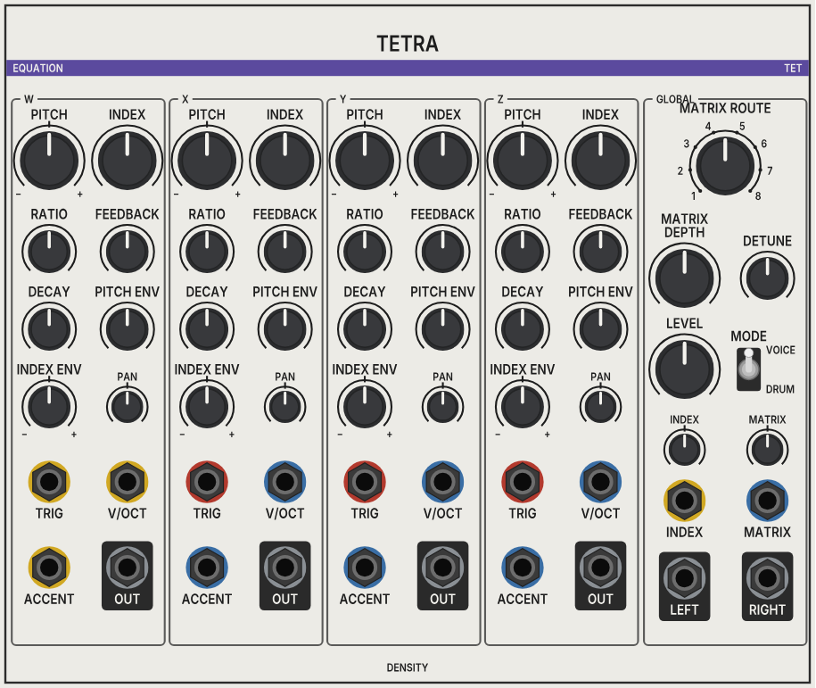
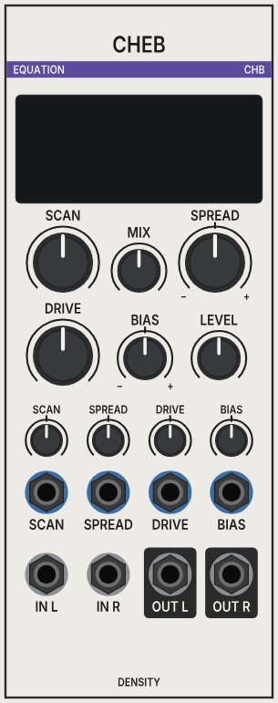

# Density for VCV Rack

**Version 2.0.0.** Eight modules for dense, drifting, self-generating material: drones built from harmonic spectra, long gestural modulation loops, deep effect chains and equation-driven rhythms. Generate material first, perform later.

## 1. Introduction

Density is a set of independent designs inspired by three instruments from Destiny+ (destiny-plus.com). **They are not emulations.** Destiny+ publishes no firmware, schematics or DSP equations, so everything here is our own design, built from the published controls, signal flow and demo videos. Destiny+ is not involved with this plugin, and none of its product or algorithm names are used on the panels.

- **Programma 900 2.0** is a "harmonic musical computer": six additive voices shaped by odd, even, partial-count and tilt sliders, 32 gestural CV buffers, and nine effect algorithms. It inspired the **HARMONIC** family: **HARMONIA**, **TRACE** and **NONET** (amber stripe).
- **entanglement space** is a four-core effects processor with 64 programs, 12 modulators, four voltage-controlled gates and a pan mixer. It inspired the **ENTANGLE** family: **TANGLE** and **WEAVE** (teal stripe).
- **model-Q-2** is a small system built on ten "algorithmic equations", eight phase-modulation oscillators and a Chebyshev waveshaper. It inspired the **EQUATION** family: **AXIOM**, **TETRA** and **CHEB** (violet stripe).

| Module | Search | HP | What it does |
|---|---|---|---|
| HARMONIA | HRM | 56 | Six additive harmonic voices with morph banks, harmonic lock and three pan locations |
| TRACE | TRC | 26 | Eight hand-played CV recorders: hold to record, release to loop |
| NONET | NON | 18 | Stereo effect with nine algorithms, three modes each |
| TANGLE | TGL | 22 | One effects core with 64 programs; cores side by side entangle |
| WEAVE | WVE | 32 | Twelve coupled complex modulators, four gates, four-input pan mixer |
| AXIOM | AXM | 28 | Ten equations making four polyrhythmic pulse channels with accent and pitch |
| TETRA | TET | 30 | Four two-operator PM voices with a cross-modulation matrix |
| CHEB | CHB | 10 | Stereo Chebyshev (second kind) waveshaper with 40 scannable shapers |

Type the short name (HRM, TRC, ...) or "density" in Rack's module browser to find them.

**Install:** download `Density-2.0.0-mac-arm64.vcvplugin` from the GitHub Actions artifact or release and drop it into Rack's user folder `plugins-mac-arm64` (Rack 2, Apple silicon).

## 2. Levels and conventions

- Audio ±5 V. CV ±5 V or 0 to 10 V. Pitch 1 V/oct with 0 V = C4. Gates and triggers fire on a rise through +1 V and re-arm below +0.1 V.
- Jack rings show the kind: **grey** audio, **blue** CV, **red** gate or trigger, **yellow** polyphonic. Outputs sit on dark plates.
- **CV inputs** add to their knob. The small trimpot beside or above each CV jack is its amount (−100% to +100%, default +100%). 10 V at +100% sweeps a knob's full range unless a table says otherwise.
- Every output and internal feedback state is soft-limited at ±12 V, and every module resets itself if anything becomes non-finite, so self-patching is safe.
- **The display exception.** NONET's P1 to P6 and TANGLE's POT 1 to POT 6 change meaning with the algorithm or program. Their panel labels are therefore generic; the module's display always shows what each one does and its value, and the knob tooltips are renamed to match.
- **Grid labels.** TRACE's eight lanes and WEAVE's gates and mixer are grids: the column header names the control in every row, and TRACE numbers its rows 1 to 8.
- Turning NONET's ALGORITHM or TANGLE's BANK/PROGRAM knob loads that algorithm's or program's default P/POT settings (context menu to turn this off). Changing them by CV does not move the knobs.

## 3. HARMONIA (HRM): six additive harmonic voices

Six voices, each a harmonic spectrum shaped by six sliders. With nothing patched they drone (an open chord: C3, G3, E4, G2, D4, C2), so HARMONIA is a whole instrument on its own. Patch V/OCT and GATE to play it.

Each voice's spectrum: harmonic *n* gets weight **ODD** (odd *n*, including the fundamental) or **EVEN** (even *n*), times a lean `n^−p` where **TILT** sets *p* from 3 (dark, TILT −1) through 1.25 (TILT 0) to −0.5 (bright, TILT +1). **PARTIALS** sets how many harmonics sound, 1 to 640, on a squared curve so the low counts are easy to set; harmonics above 0.45 × the sample rate are always removed. Each voice is played from a 2048-point wavetable, rebuilt (and crossfaded over 256 samples) whenever its spectrum changes.

| Control | What it does |
|---|---|
| ODD, EVEN, PARTIALS, TILT | The spectrum (above). The display shows the first 32 harmonics, the partial count and the note |
| TUNE | ±12 semitones (context menu: snap to semitones) |
| OCTAVE | −3 to +3 octaves |
| MULT | Self-modulation: the voice phase-modulates itself by its own last output, at MULT DEPTH. Runs at 2× oversampling |
| ROOT | Base pitch for all voices, ±2 V; 0 V = C3 |
| MULT DEPTH | Self-modulation index for voices with MULT on |
| HARMONIC LOCK | Voices 2 to 6 follow voice 1's TILT |
| STORE A, STORE B | Capture all six ODD/EVEN/PARTIALS/TILT settings into a morph bank (LED on when filled; saved with the patch) |
| MORPH (button) and MORPH (knob) | With the button on and both banks filled, the spectra come from the banks, blended by the knob; otherwise the LED blinks and the sliders stay in charge |
| DICE | Randomises ODD, EVEN, PARTIALS (biased low), TILT and MULT. Never touches TUNE, OCTAVE or the envelope |
| LOCATION A, B, C | Pan positions. Voices 2 and 5 sit at A, 1 and 3 at B, 4 and 6 at C |
| ATTACK, DECAY, SUSTAIN, RELEASE | Envelope for ONE SHOT; ATTACK/DECAY also shape CYCLE |
| RATE, SPREAD, FM FADE, LEVEL | RATE: speed of CYCLE and of the DRONE breathing. SPREAD: how far apart in time the voices breathe or cycle. FM FADE: + makes the MULT index follow the envelope, − makes it rise as the envelope falls. LEVEL: output level |
| ENVELOPE | **DRONE**: always on, voices swell in turn by RATE and SPREAD (with GATE patched it behaves like CYCLE held by the gate). **ONE SHOT**: ADSR per note. **CYCLE**: attack-decay loops at RATE while the gate is high (always, if GATE is unpatched) |
| ASSIGN | **STACK**: every voice plays the lowest held note with its own TUNE/OCTAVE (a chord). **ROUND ROBIN**: each new gate takes the next voice. **CHANNEL**: poly channel *i* plays voice *i* |
| Inputs | V/OCT and GATE (poly, up to 6). ODD/EVEN/PART/TILT CV (poly, channel *i* → voice *i*, mono → all). MORPH CV. LOC A/B/C CV (±5 V = full pan). DICE trigger |
| Outputs | LEFT, RIGHT. VOICES (6 channels, post-envelope, pre-pan). ENVELOPES (6 channels, 0 to 10 V) |

Context menu: snap tune to semitones; phases aligned or spread (spread, the default, keeps the crest factor low); clear morph banks.

**Patches**
- *Organ of spectra:* MIDI-CV (poly 6) V/OCT and GATE → HARMONIA V/OCT, GATE; ENVELOPE ONE SHOT, ASSIGN ROUND ROBIN; play chords, then move the TILT sliders.
- *Breathing drone:* nothing patched, ENVELOPE DRONE, SPREAD 0.8, RATE 0.05 Hz; LEFT/RIGHT → NONET.
- *Envelopes as modulators:* ENVELOPES (poly) → a VCV Split; each channel → a TANGLE POT CV.

## 4. TRACE (TRC): eight gestural CV recorders

Eight lanes, each a long CV recorder (up to 5 minutes at 1 kHz) that you play by hand. Turn SOURCE (or patch IN) while holding REC, and the gesture loops.

| State | REC light | Output |
|---|---|---|
| ASLEEP | off | 0 V |
| AWAKE | dim white | the live SOURCE or IN, through ATTEN and OFFSET |
| RECORDING | red, blinking | the live source, while it is written |
| LOOPING | green, flashes once per loop | the recording, at SPEED ÷ SLOW, through ATTEN and OFFSET |

- **Short press** (< 0.3 s): ASLEEP ↔ AWAKE; LOOPING → AWAKE (the loop stops).
- **Hold** (≥ 0.3 s): start recording from the moment the button went down (a 0.3 s pre-roll is kept). **Release**: loop.
- **Double press** (within 0.35 s): clear the lane and sleep. Recording stops on its own after 5 minutes and loops.

| Control | What it does |
|---|---|
| SOURCE | The hand gesture, −5 to +5 V (recorded when IN is unpatched) |
| REC | The state button above |
| OFFSET, ATTEN | Added and scaled on playback (ATTEN before OFFSET) |
| SPEED | 0.25× to 4×, detent at 1× |
| IN | Records this instead of SOURCE |
| SLOW | 1×, 2×, 4× or 8× slow-down of every lane |
| SUB LOOP | Each looping lane plays a random section (1/8 to 1/2 of its loop), re-chosen at every wrap |
| RANDOM PHASE (button, jack) | Every looping lane jumps to a random point, crossfaded over 5 ms |
| CLEAR ALL (button, jack) | Clears every lane |
| REC GATES | Poly gates: channel *i* holds lane *i*'s REC button, so a sequencer or MIDI controller can record |
| ALL | All eight lanes as one 8-channel cable |

Recordings are saved with the patch (16-bit, about 0.4 mV resolution). Context menu: "Save recordings with patch" (on by default; off reopens every lane asleep).

**Patches**
- *Hand-drawn panning:* lanes 1 to 3 → HARMONIA LOC A/B/C CV; record slow sweeps of SOURCE on each.
- *Controller gestures:* map a MIDI controller to the SOURCE knobs with VCV MIDI-Map or Stoermelder MIDI-CAT; record with REC GATES from MIDI-CV gates.
- *Stuttering memory:* record lane 1 for 20 s, SUB LOOP on, SLOW 4×, OUT → CHEB SCAN CV.

## 5. NONET (NON): nine stereo effect algorithms

One algorithm runs at a time, each with three modes. FILTER and MIX act the same on all of them; P1 to P6 change meaning per algorithm and the display names them. Changing algorithm fades the wet signal out and back in over 20 ms and clears the new algorithm's buffers.

| Control | What it does |
|---|---|
| ALGORITHM | 1 to 9 (table below); ALG CV adds 0 to 8 over 0 to 10 V |
| MODE | Cycles modes 1 → 2 → 3 (LEDs 1 2 3; MODE trigger input too) |
| RESTART | Clears the current algorithm's buffers (button and trigger) |
| FILTER | Wet-signal tilt: left is a lowpass down to 200 Hz, right a highpass up to 2 kHz, centre bypass. Inside the feedback loop of LONG DELAY |
| MIX | Equal-power dry/wet (MIX CV with trimpot) |
| P1 to P6 | Per algorithm, below; each with a CV jack and trimpot |
| CLOCK | Clock for LONG DELAY mode 2. With a clock patched, P1 RATE of algorithms 2, 5 and 6 picks a multiple of the clock rate (1/16 to 64) |
| IN L, IN R | Right is normalled to left |

| # | Algorithm | P1 | P2 | P3 | P4 | P5 | P6 | Modes |
|---|---|---|---|---|---|---|---|---|
| 1 | LONG DELAY | TIME L (10 ms to 6 min) | TIME R | FEEDBACK | AGE | DRIFT | CROSS | FREE, CLOCK, REVERSE |
| 2 | SIXTEEN PHASER | RATE | SPREAD | RESONANCE (±) | SWEEP | CENTRE | STEREO | SINE, TRIANGLE, FOLLOW |
| 3 | HADAMARD SPACE | SPACE | TIME L | TIME R | MOTION | PREDELAY | DIFFUSE | ROOM, HALL, FREEZE |
| 4 | SHIFTING SPACE | DECAY | BALANCE | SHIFT | SIZE | SHIFT AMOUNT | SHIFT DRIFT | IN LOOP, ON TAIL, SPLIT |
| 5 | PHASER SPACE | RATE | SPREAD | RESONANCE | RANGE | SPACE MIX | SPACE TIME | PHASE>SPACE, SPACE>PHASE, PHASE IN SPACE |
| 6 | STRETCH FLANGER | FREQUENCY | STRETCH | FEEDBACK (±) | DEPTH | ZERO POINT | STRETCH MIX | SINE, RANDOM, FOLLOW |
| 7 | GRAIN CLOUD | DENSITY | STRETCH | POSITION | SCATTER | PITCH (±24 st) | SIZE | FORWARD, REVERSE, MIXED |
| 8 | SCAN SPACE | SCAN RATE | STRETCH | ALLPASS TIME | FEEDBACK | DAMP | SPACE MIX | FORWARD, PENDULUM, JUMPS |
| 9 | TWIN SCAN | BASE DELAY | DEPTH | FEEDBACK (±) | ALLPASS TIME | ALLPASS MIX | PRE-DELAY | TWIN, CROSS, RUNAWAY |

**STRETCH (algorithms 6, 7, 8).** Below halfway the algorithm works on the live input. Turning STRETCH past halfway starts recording a 12-second stereo buffer, read back more slowly the further you turn (1× at halfway, 0.25× fully up), so the sound stretches. After 12 seconds the buffer stops recording and loops. Turning STRETCH right down (below 2%) clears it. The display shows LIVE, REC or LOOP and the position.

**LONG DELAY** holds up to 6 minutes per channel at 48 kHz (about 70 MB). Context menu: "Long delay buffer: 6 min / 1 min". At 96 kHz the maximum time halves; the display shows the buffer length.

**Patches**
- *Endless hall:* HARMONIA → NONET algorithm 3, mode 2 (HALL), TIME L 0.7, TIME R 0.75, MIX 0.6. Switch to mode 3 (FREEZE) to hold the tail and play over it.
- *Climbing tails:* algorithm 4, mode 1, SHIFT a little right of centre, DECAY high; short TETRA notes in.
- *Six-minute memory:* algorithm 1, TIME L and TIME R near maximum, FEEDBACK 0.9, AGE 0.4; play for a while and let the past come back.

## 6. TANGLE (TGL): one entangled effects core

One stereo effects core with four banks of sixteen programs. Each program is a short chain of reverbs, delays, phasers, pitch and frequency shifters, filters and buffers, with six pots and sometimes a button. Programs are mostly fully wet with their own level pots, so MIX defaults to fully wet. Use up to four TANGLEs side by side and they **entangle**.

| Control | What it does |
|---|---|
| BANK, PROGRAM | A to D, 0 to 15 (BANK CV and PROGRAM CV add over 0 to 10 V) |
| POT 1 to POT 6 | Per program (table below; "—" pots do nothing) |
| BUTTON | Per program: latching or held, or unused. The BUTTON gate acts as holding it |
| ENTANGLE | + feeds the core on the left into this one; − couples them without mixing (below) |
| INPUT, MIX | Input gain (0 to 2×), equal-power dry/wet |
| ENTANGLE IN | Replaces the left neighbour as the entangle source |
| ENTANGLE OUT | Mono wet output of this core |

**Entanglement.** A TANGLE directly to the right of another receives its mono wet signal (one block late), or whatever is patched into ENTANGLE IN.
- **ENTANGLE above 0 (feed):** that signal is added to this core's input at up to unity, so four cores become one chain A → B → C → D, each still with its own outputs.
- **ENTANGLE below 0 (couple):** the signal's envelope (5 ms attack, 120 ms release, full at 5 V) pushes POT 1 up and POT 2 down by up to half their range, so one core's activity reshapes another's sound without any of its audio getting through.
- **Ring:** on the leftmost core, context menu "Entangle from rightmost core" closes the loop.
- The display shows the source (LEFT, JACK, RING or —) and a level meter.

**Bank A**

| # | Program | POT 1 | POT 2 | POT 3 | POT 4 | POT 5 | POT 6 | Button |
|---|---|---|---|---|---|---|---|---|
| A0 | VERB PITCH DLY | REVERB TIME | DIFFUSION | LOWPASS | REVERB LEVEL | PITCH | DELAY | SHIMMER LOOP (latch) |
| A1 | SIGN DELAYS | DELAY A | PITCH | FEEDBACK A | FEEDBACK B | DELAY B | SIGN BLEND | — |
| A2 | ZERO FLANGE PCH | RATE | DEPTH | FEEDBACK | LEVEL | ZERO POINT | PITCH | — |
| A3 | PHASE DLY VERB | RATE | SWEEP+DECAY | RESONANCE | MIX | DELAY | FEEDBACK | — |
| A4 | CHORUS SPACE | REVERB TIME | DAMPING | CHORUS DEPTH | WET LEVEL | INPUT ALLPASS | MIX | — |
| A5 | TWO LFO VERB | PREDELAY | REVERB TIME | LOWPASS | LEVEL | LFO A RATE | LFO B RATE | — |
| A6 | VERB CHORUS PCH | REVERB TIME | DIFFUSION | LOWPASS | REVERB LEVEL | PITCH LEVEL | PITCH | FAST CHORUS (latch) |
| A7 | TWIN REVERSE | WINDOW A | FEEDBACK A | WINDOW B | FEEDBACK B | A/B BLEND | LEVEL | — |
| A8 | DRIVE CHORUS | DRIVE | LOWPASS | RESONANCE | LEVEL | CHORUS RATE | CHORUS DEPTH | — |
| A9 | TWO LFO DELAY | LFO 1 RATE | LFO 1 DEPTH | FEEDBACK | FM AMOUNT | LFO 2 RATE | LFO 2 DEPTH | — |
| A10 | PHASE DLY 24 | RATE | RESONANCE | FEEDBACK | MIX | DELAY 1 | DELAY 2 | SCRAMBLE (hold) |
| A11 | GLITCH VERB | PREDELAY | REVERB TIME | LOWPASS | MIX | SLICE RATE | REPEAT CHANCE | — |
| A12 | RING DELAY | RING FREQ | RING DEPTH | FEEDBACK | DELAY | — | — | — |
| A13 | FLANGE PCH VERB | RATE | FEEDBACK | MIX | DEPTH | REVERB LEVEL | PITCH | — |
| A14 | FDN CHORUS SLAP | CHORUS RATE | CHORUS DEPTH | FDN LEVEL | SLAP LEVEL | SLAP WOW | — | — |
| A15 | NESTED VERB DLY | REVERB TIME | DIFFUSION | LOWPASS | LEVEL | DELAY | FEEDBACK | — |

**Bank B**

| # | Program | POT 1 | POT 2 | POT 3 | POT 4 | POT 5 | POT 6 | Button |
|---|---|---|---|---|---|---|---|---|
| B0 | SHIFT FLANGE AIR | SHIFT 1 | FLANGE FEEDBACK | SHIFT 2 | SHIFT LEVEL | ZERO POINT | TAIL FEEDBACK | AIR (latch) |
| B1 | WARP VERB | REVERB TIME | DIFFUSION | LOWPASS | LEVEL | WARP RATE | WARP DEPTH | — |
| B2 | AM TWO DELAY | AM RATE | FEEDBACK A | DELAY A | DELAY B | FEEDBACK B | LEVEL | — |
| B3 | SKY LOOPS | PREDELAY | REVERB TIME | DAMPING | LEVEL | TAIL MOD | FEEDBACK | — |
| B4 | SMALL ROOM DLY | REVERB TIME | DIFFUSION | LOWPASS | LEVEL | DELAY | FEEDBACK | — |
| B5 | PHASE DELAY | RATE | SWEEP | RESONANCE | MIX | DELAY | FEEDBACK | — |
| B6 | VERB DLY VERB | REVERB TIME | DIFFUSION | LOWPASS | LEVEL | DELAY | FEEDBACK | DEEP MOD (latch) |
| B7 | DRIVE SVF VERB | REVERB TIME | DIFFUSION | RESONANCE | REVERB LEVEL | FILTER FREQ | OUTPUT | — |
| B8 | PITCH TAIL LOOPS | PREDELAY | REVERB TIME | LOWPASS | LEVEL | TANK MOD | TAIL PITCH | — |
| B9 | AM DOUBLE DLY | DELAY A | FEEDBACK A | DELAY B | FEEDBACK B | AM RATE | PITCH B | — |
| B10 | CROSS MOD ROOM | PREDELAY | REVERB TIME | LOWPASS | LEVEL | MOD RATE A | MOD RATE B | — |
| B11 | SMALL PITCH TAIL | REVERB TIME | DIFFUSION | LOWPASS | LEVEL | PITCH MIX | PITCH | — |
| B12 | BANDPASS SPACE | REVERB TIME | DIFFUSION | LOWPASS | LEVEL | BAND Q | BAND FREQ | — |
| B13 | WET MOD LOOPS | REVERB TIME | DIFFUSION | LOWPASS | LEVEL | MOD RATE | TILT | — |
| B14 | ZERO WARP VERB | RATE OUT | RATE BACK | FEEDBACK | LEVEL | REVERB LEVEL | ZERO POINT | FREEZE (latch) |
| B15 | TWIN MID VERBS | TIME A | DIFFUSION A | LOWPASS A | LEVEL | TIME B | DIFFUSION B | — |

**Bank C**

| # | Program | POT 1 | POT 2 | POT 3 | POT 4 | POT 5 | POT 6 | Button |
|---|---|---|---|---|---|---|---|---|
| C0 | MIRROR SHIFTS | PITCH 1 | FEEDBACK B | PITCH 2 | SHIFT 2 LEVEL | DELAY A | DELAY B | WOBBLE (latch) |
| C1 | RING FLANGE | RING FREQ | RING DEPTH | FEEDBACK | LEVEL | FLANGE DEPTH | FLANGE RATE | — |
| C2 | CRYSTAL VERB | REVERB TIME | DIFFUSION | LOWPASS | SHIMMER PITCH | MOD RATE | MOD DEPTH | SECOND VOICE (latch) |
| C3 | DOMINO DELAYS | DELAY A | FEEDBACK A | DELAY B | FEEDBACK B | PITCH | WARP | — |
| C4 | PHASE VERB | RATE | SWEEP | MIX | RESONANCE | REVERB TIME | LOWPASS | — |
| C5 | NANO REVERSE | WINDOW | FEEDBACK | MOD DEPTH | MOD RATE | — | — | — |
| C6 | PITCH FLANGE | RATE | FEEDBACK | MIX | DEPTH | PITCH | — | — |
| C7 | LOWPASS MID VERB | REVERB TIME | DIFFUSION | LOWPASS | LEVEL | MOD RATE | MOD DEPTH | — |
| C8 | SMALL CHORUS VERB | REVERB TIME | DIFFUSION | LOWPASS | LEVEL | DIFFUSION 2 | DELAY MOD | — |
| C9 | CATHEDRAL | PREDELAY | REVERB TIME | LOWPASS | LEVEL | MOD RATE | DIFFUSION | — |
| C10 | PITCH PREDELAY | PREDELAY | REVERB TIME | LOWPASS | LEVEL | PITCH | WOBBLE RATE | — |
| C11 | PHASE CHORUS | RATE | SWEEP | RESONANCE | MIX | CHORUS DEPTH | LEVEL | — |
| C12 | DOUBLE PHASE DLY | RATE A | FEEDBACK A | RESONANCE | MIX | RATE B | FEEDBACK B | — |
| C13 | MOD DELAY CHORUS | RATE | DEPTH | LEVEL | MIX | DELAY | FEEDBACK | — |
| C14 | FLANGE VERB MOD | RATE | DEPTH | FEEDBACK | LEVEL | ZERO POINT | REVERB TIME | — |
| C15 | DANGER FDN | REVERB TIME | DIFFUSION | LOWPASS | LEVEL | MOD RATE | MOD DEPTH | — |

**Bank D**

| # | Program | POT 1 | POT 2 | POT 3 | POT 4 | POT 5 | POT 6 | Button |
|---|---|---|---|---|---|---|---|---|
| D0 | NESTED CHORUS | REVERB TIME | DIFFUSION | LOWPASS | CHORUS LEVEL | CHORUS DEPTH | — | FAST (latch) |
| D1 | ODD FLANGE PCH | RATE | PITCH | FEEDBACK | LEVEL | — | — | — |
| D2 | BANDPASS DELAY | SENSITIVITY | Q | DELAY | MOD RATE | — | — | — |
| D3 | CHORUS VERB FLANGE | RATE | DEPTH | LEVEL | FLANGE LEVEL | MOD (KEEP LOW) | FEEDBACK | — |
| D4 | RING PHASE DLY | RATE | SWEEP | RESONANCE | MIX | PHASER FEEDBACK | DELAY FEEDBACK | — |
| D5 | DOUBLE DLY CHORUS | DELAY A | FEEDBACK A | DELAY B | FEEDBACK B | CHORUS RATE | CHORUS DEPTH | — |
| D6 | DRIVE VERB FLANGE | RATE OUT | RATE BACK | FEEDBACK | LEVEL | ZERO POINT | MOD B | DRIVE (latch) |
| D7 | PINK CLOUDS | REVERB TIME | DECAY | DIFFUSION | LEVEL | — | — | — |
| D8 | TIME SCANNER | LOOP LENGTH | SCAN SPEED | MIX | — | — | — | HOLD TO LOOP (hold) |
| D9 | PHASE VERB B | PREDELAY | REVERB TIME | LOWPASS | LEVEL | PHASE RATE | PHASE RANGE | — |
| D10 | FLANGE DLY MOD | RATE | DEPTH | FEEDBACK | LEVEL | ZERO POINT | DELAY | — |
| D11 | NESTED LOOPS | REVERB TIME | DIFFUSION | LOWPASS | LEVEL | MOD RATE | MOD DEPTH | — |
| D12 | RING CHORUS VERB | RING FREQ | RING DEPTH | CHORUS RATE | CHORUS DEPTH | LEVEL | — | — |
| D13 | BUFFER FLANGE | POINTER RATE | FEEDBACK | DEPTH (RESTRAINT) | ZERO POINT | RATE OUT | — | CHAOS (hold) |
| D14 | TREMOLO VERB | REVERB TIME | DIFFUSION | HIGHPASS | LEVEL | TREM RATE 1 | TREM RATE 2 | — |
| D15 | RING PHASER | RING FREQ | RING DEPTH | PHASER RATE | PHASER FEEDBACK | RESONANCE | PHASER MIX | — |

Pot kinds: reverb times are plate decay or RT60 up to 30 s; LOWPASS 400 Hz to 18 kHz; PITCH ±12 semitones with a dead zone at the centre; SHIFT ±500 Hz on a cubic curve; FEEDBACK up to 105% (saturating); RATE 0.02 to 12 Hz. The display shows each value in its unit.

**Patches**
- *Two cores, one space:* TANGLE A0 → TANGLE B1 to its right, ENTANGLE +0.7 on the second; listen to the second core's output.
- *Shimmer on demand:* A0, latch the button (SHIMMER LOOP); WEAVE modulator 1 → POT 5 CV.

## 7. WEAVE (WVE): modulators, gates and mixer

**Twelve complex modulators** in a chain: each modulator frequency-modulates the next by COUPLE, so they drift in related, non-repeating patterns. SHAPE morphs continuously: sine → triangle → ramp → stepped random → smooth random → logistic chaos → Lorenz, with neighbouring shapes crossfaded.

| Control | What it does |
|---|---|
| RATE (×12) | 0.005 to 50 Hz; defaults spread from 0.05 Hz upward by 1.5× |
| SHAPE (×12) | The shape morph above |
| 1 to 12 | Modulator outputs |
| COUPLE | FM of each modulator by the previous one, up to ±2 octaves |
| SPEED | Multiplies every rate by ×0.01 to ×100; SPEED CV is 1 V/oct on all rates |
| BIPOLAR / UNIPOLAR | ±5 V or 0 to 10 V outputs |
| RESET | Phases to zero, random states reseeded from the patch's seed |
| ALL | 12 channels |

**Four gates.** IN, CV (0 to 10 V), LEVEL (CV amount), RESPONSE and OUT per row. With nothing in CV, gate *j* follows modulator 3, 6, 9 or 12 (context menu turns this off; the gate is then a plain level). VCA: `in × (cv/10)²`. LPG: a vactrol-like response (5 ms rise, slow fall that slows further as it closes) that sets both level and a lowpass from 80 Hz to 18 kHz. BOTH: LPG filtering with VCA level.

**Mixer.** Four MIX IN jacks (each normalled from its gate's OUT), LEVEL, PAN and PAN CV (±5 V = full pan), equal-power to MIX L and MIX R.

**Patches**
- *Self-moving mixer:* four sound sources into the four gate INs, RESPONSE LPG, nothing in CV: they fade in and out by modulators 3, 6, 9, 12; take MIX L/R.
- *Chaos to filter:* SHAPE 9 to 0.9 (chaos) → CHEB SCAN CV.

## 8. AXIOM (AXM): ten equations, four pulse channels

Four channels, W X Y Z. Each picks one of ten equations and turns it into a gate stream, an accent CV and a pitch CV. Each runs at its own ratio of the clock, so they form polyrhythms.

| Control | What it does |
|---|---|
| TEMPO, RUN | Internal clock 20 to 300 BPM in 16th-note steps (used when CLOCK is unpatched) |
| COMPLEXITY | Tier 1 below 33%: plain equations. Tier 2: each channel's A is pushed by the previous channel's value (Z feeds W). Tier 3: also, at each wrap, ROTATE advances by the channel's last value, so patterns walk |
| LOGIC | OFF, XOR, AND or OR: each gate combined with the channel to its left (W with Z) |
| RANGE, SCALE | Pitch span 0 to 5 octaves, quantised to CHROMATIC, MAJOR, MINOR, DORIAN, PENTATONIC, WHOLE TONE or HARMONIC (partials 1 to 7) |
| SEED | New random seed (saved with the patch) for the equations that use one |
| LENGTH, RATIO, ROTATE | Steps before the equation restarts (1 to 64, or ∞ fully clockwise); step rate relative to the clock (1/4 to 4); start offset |
| EQUATION, A, B | The equation and its two parameters (named on the display) |
| Inputs | CLOCK (each rise is one 16th), RESET, EQUATION CV (poly, per channel, 0 to 10 V adds 0 to 9), A and B CV per channel |
| Outputs | GATE (10 V, half a step; context menu for 5 ms triggers), ACC (0 to 10 V), PITCH (1 V/oct) per channel; GATES, PITCHES, ACCENTS as 4-channel poly cables |

| # | Equation | A | B | Gate |
|---|---|---|---|---|
| 1 | EUCLID | PULSES | ACCENT EVERY | Euclidean pattern of A pulses over LENGTH; every Nth pulse accented |
| 2 | RATIO | P | Q | Two even pulse trains of P and Q over the length; both together accent |
| 3 | LOGISTIC | R (3.4 to 4) | THRESHOLD | Logistic map, gate above the threshold; restarts each length |
| 4 | MODULO | MULTIPLIER | WINDOW | Gate when `(step × M) mod L` falls inside the window |
| 5 | COLLATZ | START | ODD/EVEN | Collatz sequence from START; gate on odd (or even) values |
| 6 | GOLDEN | ALPHA (50% = golden ratio) | OFFSET | Beatty / Sturmian word: maximally even, never repeating with LENGTH ∞ |
| 7 | PRIMES | STRIDE | OFFSET | Gate when `step × stride + offset` is prime |
| 8 | AUTOMATON | RULE (0 to 255) | CELL | Elementary cellular automaton of 16 cells; gate = the chosen cell |
| 9 | GRAY | BIT | INVERT | One bit of the Gray code of the step |
| 10 | LORENZ | SPEED | THRESHOLD | Lorenz attractor; gate when x crosses the threshold upward |

Accent is the equation's value at each gate (0 to 10 V); pitch is the same value × RANGE, quantised.

**Patches**
- *Four cables, one drum machine:* GATES → TETRA TRIG W, PITCHES → TETRA V/OCT W, ACCENTS → TETRA ACCENT W; TETRA MODE DRUM.
- *Walking rhythm:* all four channels EUCLID with different LENGTHs (16, 12, 7, ∞), COMPLEXITY 0.8.

## 9. TETRA (TET): four phase-modulation voices

Four voices, W X Y Z, each a two-operator phase-modulation pair (a modulator with feedback driving a carrier), plus a matrix where voices modulate each other.

| Control | What it does |
|---|---|
| PITCH | ±4 octaves, added to V/OCT |
| INDEX | PM index 0 to 8 radians (INDEX CV: poly, per voice) |
| RATIO | Modulator : carrier, 0.5 to 7 harmonic, then 1.414, 2.76, 3.14, 5.19, 7.13 for metals and bells |
| FEEDBACK | Modulator self-feedback |
| DECAY | 5 ms to 5 s (to −60 dB in DRUM mode; release in VOICE mode) |
| PITCH ENV | Pitch drop at the attack, 0 to 4 octaves (1.5 is a good kick) |
| INDEX ENV | How much the index follows the envelope; negative makes it rise as the note dies |
| PAN | Stereo position |
| MODE | VOICE: 3 ms attack, holds while the gate is high. DRUM: trigger only, 0.5 ms attack, exponential decay, pitch envelope, a short noise click |
| MATRIX ROUTE | 1 NONE, 2 RING W→X→Y→Z→W, 3 PAIRS W↔X Y↔Z, 4 TO W, 5 CASCADE, 6 FROM W, 7 REVERSE RING, 8 MESH |
| MATRIX DEPTH | Cross-modulation depth, up to index 4 (MATRIX CV) |
| DETUNE | Each carrier detuned by up to ±50 cents in a fixed pattern |
| LEVEL | Mix level |
| TRIG, V/OCT, ACCENT | Per voice. A poly cable in voice W's jack spreads channels 1 to 4 over W X Y Z. V/OCT is also normalled down the row (X from W, and so on). ACCENT 0 to 10 V scales level (0.4 to 1) and index (0.5× to 1.5×) |
| OUT, LEFT, RIGHT | Each voice post-envelope, and the panned mix |

**Patches**
- *Bells:* VOICE mode, RATIO 3.14 and 5.19, INDEX 3, INDEX ENV +0.8, DECAY 3 s; MATRIX ROUTE 8 at 0.2.
- *Metal percussion:* DRUM mode, W RATIO 1.414 with PITCH ENV 1.5 (kick), Z RATIO 7.13 with DECAY 80 ms (hats); AXIOM gates in.

## 10. CHEB (CHB): stereo Chebyshev waveshaper

A stereo waveshaper built from Chebyshev polynomials of the **second kind** (`U_n`), which, unlike the first kind, give a sine input a whole family of harmonics. There are 40 shapers in five families of eight, each a weighted sum of `U_1` to `U_10`: 0 to 7 SINGLE (one polynomial each), 8 to 15 DECAY (falling weights), 16 to 23 ODD/EVEN, 24 to 31 FORMANT (a bump of weights), 32 to 39 RANDOM (fixed). SCAN moves smoothly between neighbours. Everything runs at 4× oversampling.

| Control | What it does |
|---|---|
| SCAN | Shaper 0 to 39 (display: number, family and curves; amber is left, grey is right) |
| SPREAD | Right channel scans SCAN + SPREAD (±8, wrapping), for stereo width |
| DRIVE | 0.1× to 4× into the shaper (soft-clipped so it never leaves the polynomial's range) |
| BIAS | DC offset before shaping: brings in even harmonics |
| MIX, LEVEL | Dry/wet and output level (0 to 2×) |
| CV | SCAN (10 V = all 40), SPREAD (±5 V = ±8), DRIVE (10 V = full range), BIAS (±5 V = ±0.5), each with a trimpot |

**Patches**
- *Scanning timbre:* TETRA LEFT/RIGHT → CHEB, WEAVE modulator 2 → SCAN CV, SPREAD 3.
- *Formant voice:* a sine from any VCO, SCAN 24 to 31 (FORMANT), DRIVE 1.5, slow LFO on SCAN.

## 11. Patch recipes

Cables are written `module OUTPUT → module INPUT`. Start from default settings unless a knob is named.

### Harmonic drone
- HARMONIA alone, ENVELOPE DRONE, SPREAD 0.5, RATE 0.05 Hz.
- TRACE OUT 1 → HARMONIA LOC A CV, OUT 2 → LOC B CV, OUT 3 → LOC C CV. Hold REC on each lane in turn and sweep SOURCE slowly for 10 to 30 seconds.
- TRACE OUT 4 → HARMONIA TILT CV (trimpot +50%); record a slow gesture.
- HARMONIA LEFT/RIGHT → NONET IN L/IN R; NONET ALGORITHM 3 (HADAMARD SPACE), MODE 2 (HALL), MIX 0.5.
- **Listen for:** voices moving around the stereo field in your own hand gestures, the spectrum darkening and brightening, a large hall around it.

### Morphing chord
- Set the six voices to one spectrum (for example, all EVEN at 0, PARTIALS low) and press STORE A. Set another (EVEN high, PARTIALS high, TILT bright) and press STORE B. Turn MORPH (button) on.
- TRACE OUT 5 → HARMONIA MORPH CV. Record a slow MORPH gesture on lane 5 by sweeping SOURCE between 0 and +5 V.
- ENVELOPE CYCLE, RATE 0.2 Hz, SPREAD 0.6.
- **Listen for:** a chord that keeps changing colour while its voices pulse in turn.

### Stretched memory
- Any source → NONET IN L. ALGORITHM 7 (GRAIN CLOUD).
- Turn P2 (STRETCH) past halfway. The display shows REC; wait 12 seconds until it shows LOOP.
- Now play P3 (POSITION) and P5 (PITCH); try MODE 3 (MIXED). Turn STRETCH fully down to forget.
- **Listen for:** the last 12 seconds, slowed and scattered into a cloud.

### Four entangled cores
- Four TANGLEs side by side: banks A, B, C and D (BANK knob), any programs.
- ENTANGLE +0.6 on the second, third and fourth.
- WEAVE outputs 1 to 6 → the POT 1 CV of each core and POT 2 CV of the first two (trimpots around 30%).
- Each TANGLE's OUT L → a WEAVE gate IN (1 to 4); take WEAVE MIX L/R.
- **Listen for:** one sound passing through four characters, each layer breathing in and out through the gates.

### Coupled cores
- The same patch with ENTANGLE −0.8 on cores two to four.
- **Listen for:** the cores no longer pass audio to each other; instead, loud moments in one core reshape the next (its POT 1 rises and POT 2 falls).

### Equation rhythm
- AXIOM GATES → TETRA TRIG W, PITCHES → V/OCT W, ACCENTS → ACCENT W (all poly). TETRA MODE DRUM.
- TETRA LEFT/RIGHT → CHEB IN L/IN R. WEAVE output 2 → CHEB SCAN CV (trimpot 40%).
- CHEB OUT L/R → TANGLE IN L/R, BANK D.
- AXIOM: W EUCLID, X RATIO, Y LOGISTIC, Z GOLDEN; RATIO 1 on all; COMPLEXITY 0.5.
- **Listen for:** four drum voices in shifting polyrhythm, their timbre swept by the Chebyshev scan.

### Polyrhythmic melody
- AXIOM RATIOs 1, 3/2, 4/3 and 5/4; equations W RATIO, X GOLDEN, Y RATIO, Z GOLDEN; SCALE PENTATONIC, RANGE 2.
- AXIOM GATES/PITCHES/ACCENTS → TETRA TRIG W/V/OCT W/ACCENT W. TETRA MODE VOICE, MATRIX ROUTE 2 (RING) at 0.3, DECAY around 1 s.
- TETRA LEFT/RIGHT → NONET, ALGORITHM 4 (SHIFTING SPACE), MIX 0.5.
- **Listen for:** four melodic lines at different speeds, tails that slowly climb in pitch.

### Self-playing system
- Build the harmonic drone, the four entangled cores and the equation rhythm together. Use WEAVE modulators for anything not yet moving (HARMONIA TILT CV, TANGLE POTs, TETRA INDEX CV, CHEB SCAN).
- Record the parts as stems with VCV Recorder while it plays itself; perform with them later.

## 12. Leaning on existing VCV modules

| Need | Use | Why |
|---|---|---|
| Gesture control | Any MIDI controller via VCV MIDI-Map or Stoermelder MIDI-CAT, then TRACE | The originals use camera hand tracking; a controller plus TRACE is the Rack equivalent |
| MIDI note looping | VCV MIDI-CV with any recorder or sequencer | Not worth rebuilding |
| A neutral final reverb | Valley Plateau, Surge XT reverbs | TANGLE's programs are characterful, not neutral |
| Larger mixing | MindMeld MixMaster, VCV Mixer | WEAVE's mixer has four channels |
| Recording stems | VCV Recorder | Generate first, perform later |

## 13. Credits and sources

Density is an independent, inspired-by design. All formulas, ranges, defaults, effect topologies, TANGLE's program chains and names, the entanglement mechanism, WEAVE's shapes, AXIOM's equations, TETRA's routes and CHEB's weight tables are our own. See `docs/DECISIONS.md` for every choice made during the build and `docs/CREDITS.md` for references.

- Destiny+: https://www.destiny-plus.com/ (Programma 900 2.0, entanglement space, model-Q-2 and Double Q pages); Programma 900 v2 manual; Double Q quick start.
- Jon Dattorro, "Effect Design Part 1: Reverberator and Other Filters", JAES 1997 (plate reverb).
- Olli Niemitalo, Hilbert transformer allpass coefficients.
- Panel type: Inter (SIL Open Font License).
